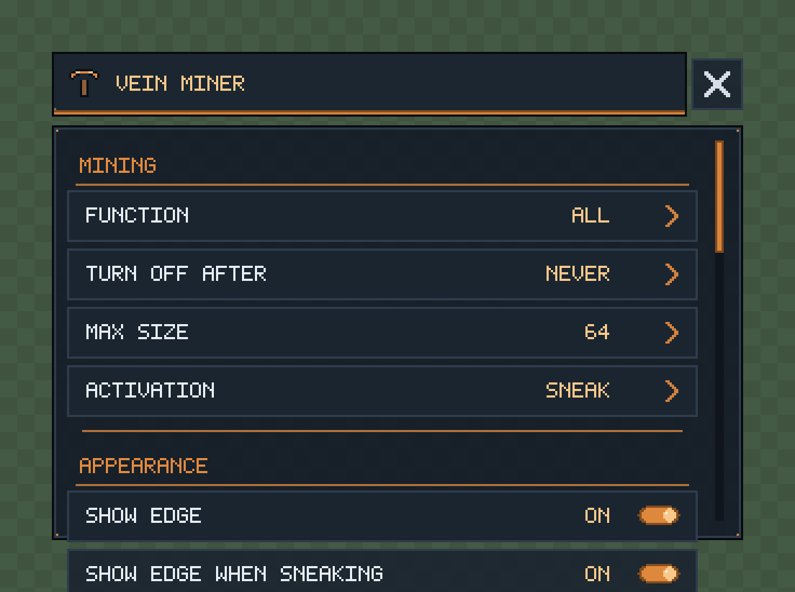

# Utils Vein Miner

[](https://github.com/axellpemula/Utilities/actions/workflows/ci.yml)

A Minecraft **Bedrock Edition** add-on that mines whole veins, digs shaped tunnels and fells trees
from a single block break, with an in-game settings panel and per-player saved preferences.

- Behaviour pack (`Utils Vein Miner BP`) — all of the logic, written against the Script API.
- Resource pack (`Utils Vein Miner RP`) — the edge-highlight entity for the live preview and the
  custom window the settings panel is drawn in.

| | |
| --- | --- |
| Minecraft | Bedrock 1.21.110+ (`min_engine_version` 1.21.110) |
| Script modules | `@minecraft/server` 2.2.0, `@minecraft/server-ui` 2.0.0 |
| Version | 5.10.0 |
| Author | xVoid_Axell |

> **The two packs must be installed together.** The behaviour pack declares the resource pack as a
> dependency, so Bedrock will not load it on its own; all of the UI strings live in the resource pack.

## Install

1. Run `npm run build` and open `dist/Utils Vein Miner v5.10.0.mcaddon` (**recommended**), or
2. Copy `Utils Vein Miner BP` and `Utils Vein Miner RP` into
   `development_behavior_packs/` and `development_resource_packs/`, then enable both in the world.
3. Cheats/experiments are **not** required for the core features. The `/uvm:veinminer` command
   needs the world to have custom commands available (1.21.100+).

## Usage

| Action | Result |
| --- | --- |
| Sneak + break a block | Mines the whole vein/shape (respecting the selected function, size limit and durability) |
| Break a block (with **Require Sneaking** off) | Same, without sneaking — while holding a pickaxe (or only a marked one, with **Only Marked Tools**) |
| Sneak + look at a block | Shows a live edge preview of what would be broken |
| Sneak + right-click while holding a pickaxe | Cycles to the next function ("Quick Settings") |
| Sneak + right-click while looking at air with a pickaxe | Opens the settings panel |
| `/uvm:veinminer` | Opens the settings panel |
| `/uvm:veinminer <function>` | Sets the function directly |

## Functions

| Value | Description |
| --- | --- |
| `off` | Disabled |
| `all` | Every connected block of the same type (vein / tree), optionally through diagonals |
| `1x1_tunnel` … `3x3_tunnel` | Straight tunnels in the direction you are facing |
| `3x2_tunnel_small`, `3x3_tunnel_small` | Same, but only one block deep |
| `mining_tunnel` | Staircase downwards |
| `escape_tunnel` | Staircase upwards |

## Settings

Every player has their own settings, stored as a dynamic property and editable from the panel.

| Setting | Default | Notes |
| --- | --- | --- |
| Show Edge | off | Outline the blocks that would be broken |
| Show Edge When Sneaking | off | Keeps the outline visible while sneaking without hitting a block |
| Function | `all` | See the table above |
| Turn off after | never | 1/2/5/10 minutes of inactivity |
| Max Size | 64 | 16–1024 blocks, step 16, further capped by the tool's remaining durability |
| Thickness of Edges | 3 | 1–5 |
| Show Action Bar Info | on | "N Blocks Selected" / "Broken N Blocks" |
| Quick Settings | off | Sneak + right-click a block to cycle functions |
| Cancel When no Drop | on | Stops the preview/break on blocks that would drop nothing |
| No Open Panel With Pickaxe | off | Disables the sneak + right-click panel shortcut |
| Auto Function "All" | on | Ores always use the `all` shape whatever the selected function is |
| Enable Only in Ore / Log | off | Restrict the add-on to ores or logs |
| Edges Accuracy | off | Hides edges that are fully enclosed by other selected blocks |
| Connected Diagonals | on | 26-block neighbourhood instead of 6 |
| Delete Blocks | none | Stone-like blocks that are mined without drops (keeps inventories clean) |
| Require Sneaking | on | Off = vein mining also triggers while just holding a pickaxe |
| Only Marked Tools | off | Only pickaxes marked with **Mark Held Tool** (item dynamic property, travels with the tool) |
| Protect My Tool | off | Keeps the last durability point, so a vein never leaves the pickaxe about to break |
| Use Tool Profiles | off | Lets a tool carry its own function / size (saved from the **This Tool** page) |
| Never Mine | none | Blocks left untouched even inside a vein, so a base survives a careless swing |

The first page carries the everyday switches (function, turn-off timer, max size, activation,
edges, accuracy); everything else is one tap away under **More Settings**, which also offers
**Reset to Defaults**. The **Activation** page holds Require Sneaking, Only Marked Tools and the
*Mark Held Tool* action. **This Tool** stores a function/size pair on the held item, and
**Never Mine** / **Delete Blocks** are two lists of block toggles.
Every change is saved the moment it is tapped, so closing the panel never throws work away.

## The settings panel

The panel is a **custom window** rather than the plain grey Bedrock form: a JSON-UI screen with its
own nine-slice textures, a copper-on-slate title bar, toggle pills and a slim scrollbar.



How it fits together:

| Piece | What it does |
| --- | --- |
| `BP/scripts/utilities_vein_miner/lib/player/panel.js` | Pure model: pages, rows, the invisible state markers and click handling. Unit tested, no engine imports. |
| `BP/scripts/utilities_vein_miner/functions/configUI.js` | Draws each page with `ActionFormData` and saves every click immediately. |
| `RP/ui/server_form.json` | Replaces one control of the vanilla form screen: a long form whose title carries `PANEL_TAG` is drawn with the custom window; every other long form (vanilla, other add-ons) keeps the vanilla renderer. |
| `RP/ui/uvm_settings.json` | The window itself: title bar, section headers, rows, toggle pills, scrollbar. |
| `RP/ui/_global_variables.json` | The markers shared by the script and the UI. `npm run validate` fails if they drift. |
| `BP/scripts/utilities_vein_miner/lib/player/worldConfig.js` | World defaults / Max Size cap, fed to every configuration read. |
| `RP/textures/ui/utilities_vein_miner/` | The textures, generated by `tools/gen_ui_textures.py` (pure Python, no Pillow). |

The resource pack stays optional. Without it the very same form is rendered by the vanilla long form
renderer, with the current value spelled out on every row (`Show Edge  ON`), so the panel is fully
usable either way.

```bash
npm run ui         # re-render the textures + docs/settings-panel-preview.png (needs python3)
```

**Adding a setting:** add the field to `DEFAULT_CONFIG`, add a row where it belongs in
`lib/player/panel.js` and a label to both `.lang` files. `npm run check` then catches a row that
points at a missing translation, a texture reference that does not resolve, a broken nine-slice
descriptor and a marker that drifted between the script and the UI.

## Commands

```
/uvm:veinminer                  # settings panel
/uvm:veinminer <function>       # off | all | 1x1_tunnel | ... | escape_tunnel
/uvm:veinminer_preset <name>    # miner | builder | lumberjack | off
/uvm:veinminer_stats            # a two line summary of your settings
/uvm:veinminer_world            # the world cap and default function
```

Available to all players (`cheatsRequired: false`). The two `stats`/`world` commands are read only,
so a support conversation can start with one command instead of a walkthrough.

Operator commands (permission level *game directors*, stored on the world so a realm keeps them):

```
/uvm:veinminer_maxsize <blocks> # world wide Max Size cap, 0 removes it
/uvm:veinminer_default <function>  # starting function for players without saved settings
```

The cap is applied whenever a configuration is read or written, and the Max Size page only offers
sizes inside it.

## Development

```bash
npm run validate   # JSON, script syntax, import graph, manifests, translations
npm test           # unit tests for the shape math, config validation, durability math
npm run check      # validate + test (this is what CI runs)
npm run build      # dist/Utils Vein Miner v<version>.mcaddon
npm run ui         # regenerate the panel textures and the preview image
```

`npm install` is optional and only needed for editor IntelliSense: `@minecraft/server` and
`@minecraft/server-ui` are pinned to the exact versions declared in the manifest dependency, and
`jsconfig.json` points the editor at the pack scripts. No runtime dependency is ever bundled — the
pack ships plain ES modules that Bedrock loads directly.

### Project layout

```
Utils Vein Miner BP/
  manifest.json
  scripts/utilities_vein_miner/
    main.js                    entry point (imports the event modules, sweeps stale markers)
    events/                    build/break/hit/itemUse/join/leave/command subscriptions
    functions/                 controller, shape -> preview|break, settings panel, timers
    lib/
      block/                   block helpers, direction + tunnel math, shapes
      item/                    durability handling (math in durabilityMath.js)
      loot/                    single lazy loot-table manager
      player/                  config, delete-blocks list, options/validation, panel model, warn, timers
      util/position.js         collision-free position keys, neighbour offsets
  texts/                       pack name/description

Utils Vein Miner RP/
  entity/, models/, animations/, render_controllers/, materials/   edge marker entity
  ui/                        server_form override + the settings window
  textures/ui/utilities_vein_miner/  nine-slice textures for the window
  textures/, sounds/, texts/                                       assets + UI strings

docs/settings-panel-preview.png  mock-up of the settings window (generated)
tests/                         node:test suites (no Minecraft required)
tools/validate.mjs             pack-level static checks
tools/build.mjs                dependency-free .mcaddon packager
tools/gen_ui_textures.py       generates the window textures + the preview
```

### Notes and limitations

- **Max Size is a real cost.** The preview spawns one marker entity per exposed block and every
  break resolves loot per block; values above ~256 are heavy on low-end phones.
- The preview markers are ordinary entities with a 30 second safety despawn timer. They are removed
  immediately when you stop sneaking, disable the option or break a block, on leave, and on world
  load (stale markers from a previous session are swept).
- Quick Settings uses right-click, which conflicts with Classic GUI on phones — the panel warns
  about this when you enable it.
- With **Require Sneaking** off, only a pickaxe (or a marked tool) activates vein mining, so digging
  dirt with a shovel never starts a vein. The sneak + right-click panel shortcut stays sneak based.
- **Use Tool Profiles** stores only the function and the Max Size on the item; everything else stays
  with the player. The profile can also set the tool to `off`.
- **Never Mine** is applied to planned blocks, so the preview shows exactly what a break would take.
- **Protect My Tool** reserves one durability point for the vein-miner's own damage; the vanilla hit
  that starts the vein still costs its own point, exactly like vanilla.
- The custom window borrows the vanilla form screen through `RP/ui/server_form.json`. Forms shown
  by other packs, and every form without the panel tag, still use the vanilla renderer; the only
  thing a resource pack override cannot survive is a future vanilla redesign of that one control.
- The add-on is designed around vanilla plus the `bedrock_awakening:*` block tags; unknown blocks
  fall back to plain loot-table checks.

## License

MIT — see [LICENSE](LICENSE).
